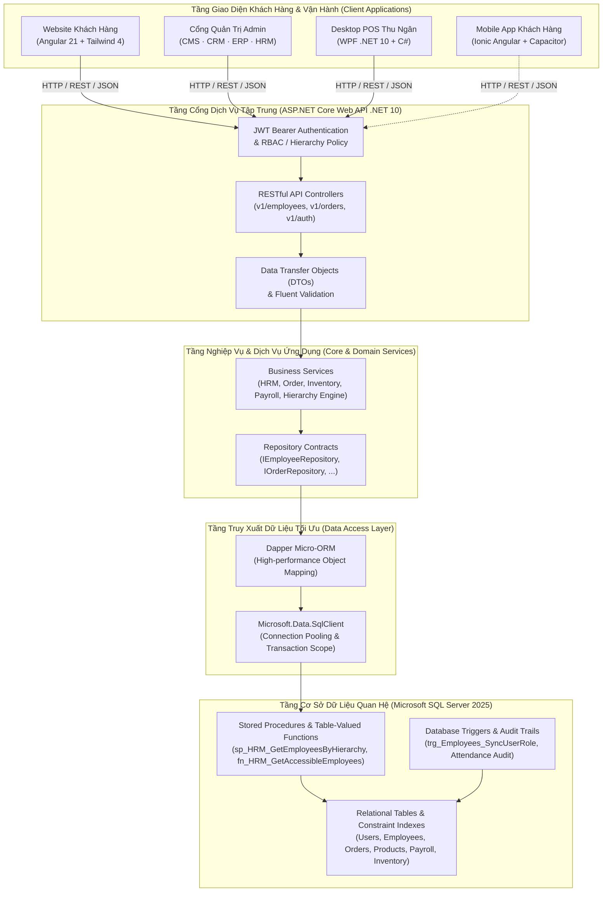
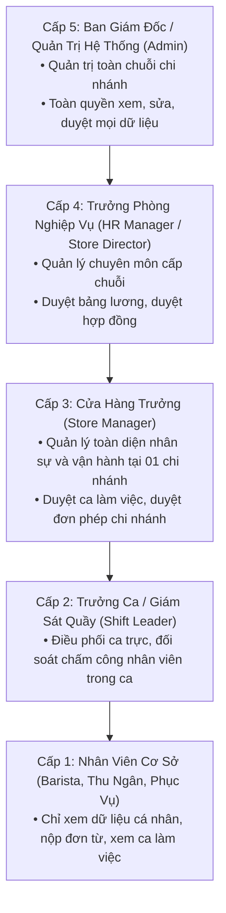

<div align="center">

# FIIN COFFEE — HỆ THỐNG QUẢN LÝ KINH DOANH QUÁN CÀ PHÊ
### Đề Tài Luận Văn Tốt Nghiệp Đại Học | Niên Khóa 2026 – 2027
**Chuyên ngành:** Công nghệ Thông tin &bull; **Sinh viên thực hiện:** Ngô Hoàng Sang

<br/>

[](https://dotnet.microsoft.com/)
[](https://dotnet.microsoft.com/apps/aspnet)
[](https://learn.microsoft.com/dotnet/csharp/)
[](https://angular.dev/)
[](https://www.typescriptlang.org/)
[](https://tailwindcss.com/)
[](https://www.microsoft.com/sql-server)
[](https://github.com/DapperLib/Dapper)
[](https://vitest.dev/)

<br/>

[Tổng Quan](#1-tổng-quan-dự-án) &bull;
[Kiến Trúc](#2-kiến-trúc-hệ-thống) &bull;
[Công Nghệ](#3-ngăn-xếp-công-nghệ-tech-stack) &bull;
[Phân Hệ Chức Năng](#4-các-phân-hệ-chức-năng-chính) &bull;
[Lược Đồ Dữ Liệu](#5-lược-đồ-dữ-liệu--phân-quyền-thẩm-quyền) &bull;
[Cài Đặt & Khởi Chạy](#7-hướng-dẫn-cài-đặt--khởi-chạy) &bull;
[Tài Khoản Thử Nghiệm](#8-tài-khoản-thử-nghiệm-1-click-demo) &bull;
[Tiến Độ Luận Văn](#10-tiến-độ-thực-hiện-luận-văn)

</div>

---

## Mục lục

- [1. Tổng Quan Dự Án](#1-tổng-quan-dự-án)
- [2. Kiến Trúc Hệ Thống](#2-kiến-trúc-hệ-thống)
- [3. Ngăn Xếp Công Nghệ (Tech Stack)](#3-ngăn-xếp-công-nghệ-tech-stack)
- [4. Các Phân Hệ Chức Năng Chính](#4-các-phân-hệ-chức-năng-chính)
  - [4.1 Phân hệ Website Khách hàng (Customer Web)](#41-phân-hệ-website-khách-hàng-customer-facing-website)
  - [4.2 Cổng Quản trị Doanh nghiệp (Admin Portal)](#42-cổng-quản-trị-doanh-nghiệp-admin-portal)
  - [4.3 Phân hệ Bán hàng tại quầy (Windows Desktop POS)](#43-phân-hệ-bán-hàng-tại-quầy-windows-desktop-pos)
  - [4.4 Phân hệ Di động Khách hàng (Mobile App)](#44-phân-hệ-di-động-khách-hàng-mobile-application)
- [5. Lược Đồ Dữ Liệu & Phân Quyền Thẩm Quyền](#5-lược-đồ-dữ-liệu--phân-quyền-thẩm-quyền)
- [6. Cấu Trúc Thư Mục Dự Án](#6-cấu-trúc-thư-mục-dự-án)
- [7. Hướng Dẫn Cài Đặt & Khởi Chạy](#7-hướng-dẫn-cài-đặt--khởi-chạy)
- [8. Tài Khoản Thử Nghiệm (1-Click Demo)](#8-tài-khoản-thử-nghiệm-1-click-demo)
- [9. Kiểm Thử & Tối Ưu Hiệu Năng](#9-kiểm-thử--tối-ưu-hiệu-năng)
- [10. Tiến Độ Thực Hiện Luận Văn](#10-tiến-độ-thực-hiện-luận-văn)
- [11. Thông Tin Tác Giả & Bản Quyền](#11-thông-tin-tác-giả--bản-quyền)

---

## 1. Tổng Quan Dự Án

**Fiin Coffee** là đồ án luận văn tốt nghiệp ngành Công nghệ Thông tin, tập trung nghiên cứu và xây dựng giải pháp chuyển đổi số toàn diện cho mô hình kinh doanh quán cà phê kết hợp chuỗi chi nhánh theo định hướng **O2O (Online-to-Offline)**.

### Bối cảnh & Giá trị cốt lõi
- **Phong cách nhận diện:** Định hình theo bản sắc **Cà phê Sài Gòn Vintage** — kết hợp không gian truyền thống ấm cúng với trải nghiệm số hóa hiện đại.
- **Hợp nhất đa kênh:** Đồng bộ hóa quy trình từ đặt hàng trực tuyến trên Website/Mobile, điều phối đơn hàng tại quầy thu ngân POS, đến hệ thống quản trị trung tâm của khối văn phòng.
- **Chuẩn hóa nghiệp vụ điều hành:** Thiết kế cổng quản trị chuyên sâu đáp ứng chuẩn nghiệp vụ kế toán, quản trị kho vận (ERP), chăm sóc khách hàng hội viên (CRM), quản lý nội dung (CMS) và quản trị nguồn nhân lực (HRM).
- **Phân cấp bảo mật đa tầng:** Mô hình cây phả hệ thẩm quyền 5 cấp từ Ban Giám đốc đến nhân viên cơ sở, kết hợp phân quyền dữ liệu cấp dòng (Row-Level Security).

> [!NOTE]
> Hệ thống được thiết kế và tối ưu hóa chặt chẽ theo tiêu chuẩn kỹ thuật phần mềm, đảm bảo khởi chạy mượt mà trên môi trường máy trạm văn phòng tiêu chuẩn (RAM 8 GB, đồ họa tích hợp).

---

## 2. Kiến Trúc Hệ Thống

Hệ thống được thiết kế theo mô hình **Kiến trúc Khối mô-đun tập trung (Modular Monolith)** với nguyên tắc phân tầng rõ ràng (Multi-tier Architecture). Toàn bộ giao tiếp giữa các ứng dụng khách (Client Applications) và dữ liệu đều được kiểm soát tập trung qua cổng Backend RESTful API.



### Nguyên tắc kiến trúc then chốt
1. **Giao tiếp dữ liệu một chiều độc quyền:** Không có bất kỳ ứng dụng frontend hoặc desktop client nào được phép mở kết nối trực tiếp đến SQL Server.
2. **Chiến lược Stored Procedures & Functions:** Toàn bộ tác vụ đọc, ghi, truy vấn phân cấp và tính toán lương/doanh thu phức tạp được đóng gói tại Stored Procedures và Table-Valued Functions để tận dụng tối đa Execution Plan của Database Engine.
3. **Tính toàn vẹn giao dịch (ACID):** Sử dụng SQL Transactions và .NET TransactionScope tại các quy trình quan trọng (thanh toán, xuất/nhập kho, chốt kỳ lương).

---

## 3. Ngăn Xếp Công Nghệ (Tech Stack)

| Phân tầng | Công nghệ / Thư viện | Phiên bản | Vai trò & Đặc điểm kỹ thuật |
|---|---|:---:|---|
| **Frontend Framework** | Angular | `21.2.x` | Ứng dụng Single Page Application (SPA), Standalone Components, Signals, OnPush change detection |
| **CSS & Styling** | Tailwind CSS & PostCSS | `v4.1.x` | Thiết kế giao diện phong cách Vintage Cà phê Sài Gòn, tối ưu hóa CSS bundle |
| **Icons & Motion** | Lucide Angular & GSAP | `1.70` / `3.15` | Hệ thống biểu tượng giao diện chuẩn văn phòng và hoạt ảnh mượt mà |
| **Frontend Testing** | Vitest & JSDOM | `4.0.x` | Khung kiểm thử tự động tốc độ cao cho tầng giao diện |
| **Backend Runtime** | .NET (C# 13) | `10.0 LTS` | Nền tảng thực thi Web API hiện đại, hiệu năng cao, tiêu thụ ít tài nguyên |
| **Web API Framework** | ASP.NET Core Web API | `10.0` | Cung cấp RESTful endpoints chuẩn hóa, xử lý Middleware, CORS, JWT |
| **Data Access** | Dapper | `2.1.89` | Micro-ORM tối ưu tốc độ map dữ liệu từ Stored Procedures về C# DTOs |
| **Database Driver** | Microsoft.Data.SqlClient | `7.1.2` | Bộ điều khiển kết nối chính thống tới SQL Server, hỗ trợ mã hóa bảo mật |
| **Database Engine** | Microsoft SQL Server | `2025` | Hệ quản trị cơ sở dữ liệu quan hệ lưu trữ tập trung dữ liệu toàn hệ thống |
| **Desktop POS** | WPF (C# / .NET 10) | `10.0` | Ứng dụng máy trạm quầy bán hàng, tích hợp mô phỏng chấm công sinh trắc học |
| **Mobile Target** | Ionic Angular + Capacitor | `Provisional` | Ứng dụng di động thực khách cho hệ sinh thái Android |

---

## 4. Các Phân Hệ Chức Năng Chính

### 4.1 Phân hệ Website Khách hàng (Customer-Facing Website)
Giao diện khách hàng được thiết kế theo nhận diện Cà phê Sài Gòn Vintage, mang đến cảm giác hoài niệm nhưng tốc độ phản hồi tức thời:

- **Landing Page (`/`):** Hero banner nghệ thuật, ký sự thương hiệu (`widget_landingAbout`), món đặc trưng Signature (`widget_landingSignature`), bản tin ưu đãi (`widget_landingNews`).
- **Thực đơn số thông minh (`/san-pham`, `/menu`):** Phân loại món đa tầng (Cà phê pha máy, Cà phê phin truyền thống, Trà thảo mộc, Trà trái cây, Bánh ngọt), tìm kiếm tức thời theo từ khóa.
- **Tùy biến khẩu vị theo sở thích (`/san-pham/:id`):** Cho phép thực khách chọn kích cỡ (Size M / L), điều chỉnh độ ngọt (100%, 70%, 50%, 30%), tỷ lệ đá và lựa chọn thêm danh mục Topping phong phú. Đơn giá tự động cập nhật thời gian thực.
- **Giỏ hàng & Đặt hàng online:** Tích hợp giỏ hàng nổi, quản lý số lượng, ghi chú đơn hàng và chuẩn bị quy trình đặt món.
- **Thẻ Thành viên Fiin Points (`/uu-dai`):** Giới thiệu chính sách tích lũy điểm thưởng với 4 hạng thẻ: *Thành viên Mới*, *Thẻ Đồng (Bronze)*, *Thẻ Bạc (Silver)*, và *Thẻ Vàng (Gold / VIP)*.
- **Trung tâm Xác thực (`/auth`, `/login`, `/register`, `/forgot-password`):** Hỗ trợ đăng nhập linh hoạt qua Email/Số điện thoại, đăng ký thành viên mới và khôi phục mật khẩu.

---

### 4.2 Cổng Quản trị Doanh nghiệp (Admin Portal)
Cổng điều hành trung tâm được phân quyền nghiêm ngặt với 4 khối quản trị chính:

```
Admin Portal (/admin)
 ├── CMS Module (/admin/cms)       ── Quản trị tin tức, banner trang chủ, danh mục & thực đơn
 ├── CRM Module (/admin/crm)       ── Quản trị khách hàng, điểm thưởng Fiin Points & khiếu nại
 ├── ERP Module (/admin/erp)       ── Quản trị định mức kho, xuất/nhập nguyên vật liệu & dòng tiền
 └── HRM Module (/admin/hrm)       ── Quản trị nhân sự chuyên sâu, chấm công, bảng lương & thẩm quyền
```

#### Trọng tâm Phân hệ HRM (Human Resource Management):
1. **Hồ sơ nhân viên đa năng (`hrm_profile`):**
   - Bộ chọn nhân viên thông minh (Lazy Combobox) tích hợp tìm kiếm tức thời và cuộn vô tận (Infinite Scrolling).
   - Thẻ định danh tinh gọn: Avatar chuẩn, mã nhân viên, chi nhánh làm việc, huy hiệu trạng thái.
   - 5 nhóm thông tin dạng Accordion đóng/mở linh hoạt:
     - *Nhóm 1:* Thông tin lý lịch & Định danh công dân (Số CCCD, ngày sinh, giới tính, nơi cấp).
     - *Nhóm 2:* Tài khoản Ngân hàng nhận lương (Tên ngân hàng, số tài khoản, tên chủ thẻ).
     - *Nhóm 3:* Hợp đồng lao động & Chế độ đãi ngộ (Loại hợp đồng, mức lương theo giờ, phụ cấp ăn ca/trách nhiệm).
     - *Nhóm 4:* Phân cấp thẩm quyền & Quy trình phê duyệt (Cấp bậc 1–5, workflow được duyệt).
     - *Nhóm 5:* Lịch sử đánh giá & Nhận xét định kỳ.
   - Thao tác văn phòng: Xuất hồ sơ ra file và nhập hồ sơ hàng loạt từ Excel.

2. **Danh sách nhân sự dạng lưới (`hrm_employees`):**
   - Thiết kế chuẩn **Bảng dữ liệu kế toán (Data Grid Table)**: Viền ô 4 phía sắc nét (`1px solid`), hàng tiêu đề cố định (`sticky header`).
   - 13 cột nghiệp vụ rõ ràng: Số liệu tiền tệ định dạng monospace căn phải, mã nhân viên và CCCD căn giữa.
   - Hàng chân bảng tổng hợp tự động ($\Sigma$): Tổng quân số, lương giờ trung bình và tổng quỹ phụ cấp chi nhánh.

3. **Quản lý Chấm công & Kiểm toán (`hrm_attendance`):**
   - Bảng lưới đối chiếu 11 cột giữa ca đăng ký và giờ quẹt vân tay thực tế.
   - Cung cấp tính năng sửa giờ chấm công minh bạch có lưu vết kiểm toán (Audit Trail).
   - Điều hướng ngày nhanh chóng (`<`, Chọn ngày, `>`, `Hôm nay`), nạp dữ liệu từ máy chấm công và xuất báo cáo.

4. **Tính toán & Bảng Lương chi tiết (`hrm_payroll`):**
   - Bảng tính lương 13 cột phản ánh: Đơn giá lương/h, giờ chuẩn, giờ tăng ca (OT), tiền OT, phụ cấp ăn trưa, trừ bảo hiểm và **Lương thực lĩnh (Net Pay)** nổi bật.
   - Quy trình kiểm tra, phê duyệt và khóa kỳ lương tháng.

---

### 4.3 Phân hệ Bán hàng tại quầy (Windows Desktop POS)
- Xây dựng trên nền tảng WPF C# .NET 10, tối ưu cho màn hình cảm ứng tại quầy thu ngân.
- Xử lý đơn hàng trực tiếp: Chọn món, thêm ghi chú, áp dụng voucher, tính tiền và in hóa đơn.
- Tiếp nhận và xử lý đơn hàng trực tuyến đồng bộ từ Website và Mobile App qua SignalR/REST API.
- **Mô phỏng điểm danh sinh trắc học:** Quy trình giả lập quẹt vân tay và nhận diện khuôn mặt nhân viên đầu/cuối ca làm việc.

---

### 4.4 Phân hệ Di động Khách hàng (Mobile Application)
- Định hướng công nghệ: **Ionic Angular + Capacitor** xuất bản bộ cài Android APK.
- Chức năng: Đặt món mang về/giao tận nơi, theo dõi trạng thái đơn hàng thời gian thực, quản lý thẻ thành viên và quét mã QR tích điểm tại quầy.

---

## 5. Lược Đồ Dữ Liệu & Phân Quyền Thẩm Quyền

### 5.1 Các bảng dữ liệu chính trong SQL Server
- **Hệ thống & Người dùng:** `Users`, `Roles`, `UserRoles`, `Permissions`.
- **Nhân sự & Chấm công:** `Departments`, `Positions`, `Employees`, `EmployeeContracts`, `Attendances`, `Payrolls`, `ApprovalWorkflows`.
- **Sản phẩm & Thực đơn:** `Categories`, `Products`, `ProductSizes`, `Toppings`, `Recipes`, `Ingredients`.
- **Bán hàng & Kho vận:** `Orders`, `OrderDetails`, `Payments`, `InventoryStocks`, `StockTransactions`, `Suppliers`.
- **Nội dung Website:** `Banners`, `Articles`, `Vouchers`, `CustomerMemberships`.

### 5.2 Cây phả hệ phân quyền thẩm quyền (Hierarchy Level 1 &rarr; 5)



- **Hàm phân quyền dữ liệu:** `dbo.fn_HRM_GetAccessibleEmployees(@CurrentUserId)` tự động giới hạn phạm vi truy vấn dữ liệu theo chi nhánh và cấp bậc của người dùng đang đăng nhập.
- **Thủ tục phân trang lười:** `dbo.sp_HRM_GetEmployeesByHierarchy` xử lý phân trang dữ liệu lớn ở tầng cơ sở dữ liệu (`OFFSET ... FETCH NEXT`), giảm tải triệt để lưu lượng mạng.

---

## 6. Cấu Trúc Thư Mục Dự Án

```
LUAN_VAN_TOT_NGHIEP_2026/
├── .agents/                        # Cấu hình quy chuẩn và kỹ năng dành cho trợ lý phát triển
├── docs/                           # Tài liệu kỹ thuật & báo cáo luận văn chính thức
│   ├── image/                      # Sơ đồ kiến trúc, sơ đồ use-case, ERD ý niệm/vật lý
│   ├── report/                     # Các chương báo cáo luận văn (Word/Docx)
│   ├── technical/                  # Đặc tả kỹ thuật (Database, HRM, API, Accounts)
│   └── template/                   # Biểu mẫu luận văn tốt nghiệp theo quy định trường
├── src/
│   ├── backend/                    # Mã nguồn giải pháp Backend .NET 10
│   │   ├── FiinCoffee.slnx         # Tệp giải pháp .NET Solution
│   │   ├── FiinCoffee.Api/         # Web API Host, Controllers, Program.cs, Middleware
│   │   ├── FiinCoffee.Core/        # Domain Models, Interfaces, DTOs, Business Entities
│   │   └── FiinCoffee.Infrastructure/ # Dapper Repositories, Database Context, Auth
│   ├── database/                   # Kịch bản SQL Server triển khai CSDL
│   │   ├── 01_init_schema.sql      # Khởi tạo bảng, khóa chính, khóa ngoại ban đầu
│   │   ├── 02_inspect_schema.sql   # Kiểm tra và đối soát cấu trúc bảng
│   │   ├── 03_hrm_schema_migration.sql # Bổ sung bảng nghiệp vụ nhân sự chuyên sâu
│   │   ├── 04_seed_hrm.sql         # Dữ liệu hạt giống cho HRM và nhân viên mẫu
│   │   ├── 05_update_employees_and_contract_types.sql
│   │   ├── 06_hrm_migration_and_routines.sql
│   │   ├── 07_hierarchical_roles_and_approval_engine.sql # Động cơ phân quyền phả hệ
│   │   ├── 08_employee_contracts_and_temporal_queries.sql
│   │   ├── 09_hierarchical_employee_queries_and_profile_engine.sql
│   │   └── 10_hrm_attendance_payroll_and_approvals.sql   # Chấm công, bảng lương & SPs
│   └── frontend/                   # Mã nguồn ứng dụng Web Khách hàng & Cổng Admin
│       ├── src/
│       │   ├── app/
│       │   │   ├── admin/          # Module Quản trị (CMS, CRM, ERP, HRM, _demo)
│       │   │   ├── components/     # Thành phần UI tái sử dụng (Button, Input, Modal, Table)
│       │   │   ├── entities/       # Khai báo kiểu dữ liệu TypeScript (Models/Interfaces)
│       │   │   ├── pages/          # Các trang độc lập (Landing, Home, Product, Auth, ...)
│       │   │   └── widgets/        # Các khối giao diện kết hợp (Header, Footer, Navbar)
│       │   └── index.html
│       ├── angular.json
│       ├── package.json
│       └── tailwind.config.js
├── tests/                          # Tầng kiểm thử tích hợp (Integration Tests)
├── AGENTS.md                       # Quy chế phân vai và nguyên tắc làm việc dự án
├── PROJECT_CONTEXT.md              # Bối cảnh, mục tiêu và quyết định kỹ thuật toàn diện
└── README.md                       # Tài liệu tổng quan của repository
```

---

## 7. Hướng Dẫn Cài Đặt & Khởi Chạy

### 7.1 Yêu cầu môi trường tiên quyết
- **Hệ điều hành:** Windows 10 / 11 (64-bit)
- **.NET SDK:** Phiên bản `.NET 10.0 SDK` (hoặc tương thích)
- **Node.js & npm:** Node.js `v20.x` hoặc `v22.x`, npm `v10+`
- **Cơ sở dữ liệu:** Microsoft SQL Server 2022 hoặc 2025 (Local instance / SQL Express)
- **Công cụ đề xuất:** Visual Studio Code hoặc Visual Studio 2026

---

### 7.2 Bước 1: Khởi tạo Cơ sở dữ liệu (SQL Server)
1. Mở **SQL Server Management Studio (SSMS)** hoặc công cụ dòng lệnh `sqlcmd`.
2. Tạo mới một cơ sở dữ liệu có tên `CoffeeShopDB`:
   ```sql
   CREATE DATABASE CoffeeShopDB;
   GO
   ```
3. Chạy tuần tự các tập tin mã nguồn SQL trong thư mục `src/database/`:
   - `01_init_schema.sql`
   - `03_hrm_schema_migration.sql`
   - `04_seed_hrm.sql`
   - `05_update_employees_and_contract_types.sql`
   - `06_hrm_migration_and_routines.sql`
   - `07_hierarchical_roles_and_approval_engine.sql`
   - `08_employee_contracts_and_temporal_queries.sql`
   - `09_hierarchical_employee_queries_and_profile_engine.sql`
   - `10_hrm_attendance_payroll_and_approvals.sql`

---

### 7.3 Bước 2: Cấu hình và Khởi chạy Backend Web API
1. Điều hướng vào thư mục Backend:
   ```bash
   cd src/backend/FiinCoffee.Api
   ```
2. Mở tệp `appsettings.json` và kiểm tra chuỗi kết nối:
   ```json
   "ConnectionStrings": {
     "DefaultConnection": "Server=localhost;Database=CoffeeShopDB;Trusted_Connection=True;TrustServerCertificate=True;MultipleActiveResultSets=true;"
   }
   ```
3. Phục hồi dependencies và chạy ứng dụng:
   ```bash
   dotnet restore
   dotnet run
   ```
4. Dịch vụ Backend sẽ chạy và sẵn sàng nhận kết nối tại `https://localhost:5001` hoặc `http://localhost:5000`. Truy cập `/swagger` để kiểm tra tài liệu API tương tác.

---

### 7.4 Bước 3: Cài đặt và Khởi chạy Frontend Web Application
1. Mở một cửa sổ dòng lệnh mới và điều hướng vào thư mục Frontend:
   ```bash
   cd src/frontend
   ```
2. Cài đặt các gói phụ thuộc (Dependencies):
   ```bash
   npm install
   ```
3. Khởi chạy máy chủ phát triển cục bộ:
   ```bash
   npm start
   ```
4. Mở trình duyệt và truy cập:
   - **Giao diện Khách hàng:** [http://localhost:4200](http://localhost:4200)
   - **Cổng Quản trị Admin:** [http://localhost:4200/admin](http://localhost:4200/admin)
   - **Trang Đăng nhập Quản trị:** [http://localhost:4200/admin/login](http://localhost:4200/admin/login)
   - **Khu vực Demo Linh kiện Dùng chung:** [http://localhost:4200/admin/_demo](http://localhost:4200/admin/_demo)

---

## 8. Tài Khoản Thử Nghiệm (1-Click Demo)

Tại giao diện đăng nhập quản trị `/admin/login`, hệ thống đã trang bị sẵn bảng **"Tài khoản kiểm thử nhanh"**. Người dùng có thể nhấn nút **"Vào ngay với vai trò này &rarr;"** để trải nghiệm phân quyền tức thời mà không cần nhập liệu thủ công:

| STT | Tài khoản (Email) | Mật khẩu | Họ và Tên | Vai trò | Phân hệ được cấp quyền | Ghi chú kiểm thử phân quyền |
|:---:|---|:---:|---|---|:---:|---|
| **1** | `admin@fiin.vn` | `admin` | Nguyễn Văn An | **Quản trị viên toàn chuỗi** | **CMS · CRM · HRM · ERP** | Thấy toàn bộ 4 phân hệ trên thanh điều hướng; toàn quyền thao tác dữ liệu. |
| **2** | `hr@fiin.vn` | `admin` | Trần Thị Mai | **Trưởng phòng Nhân sự** | **HRM** | Chỉ hiển thị tab HRM. Nếu cố tình vào CMS/ERP sẽ bị chặn chuyển hướng về màn hình cấm quyền. |
| **3** | `kinhdoanh@fiin.vn` | `admin` | Lê Hoàng Nam | **Quản lý Kinh doanh & Marketing** | **CMS · CRM** | Quản lý nội dung bài viết, banner và hồ sơ khách hàng thành viên. |
| **4** | `kho@fiin.vn` | `admin` | Võ Minh Quân | **Quản lý Chuỗi & Kho vận** | **ERP** | Chuyên trách định mức nguyên vật liệu, quản lý xuất nhập tồn kho. |
| **5** | `guest@fiin.vn` | `admin` | Phạm Thu Hà | **Nhân viên tập sự** | *(Chưa cấp quyền)* | Bị chặn truy cập toàn bộ cổng quản trị, hiển thị thông báo yêu cầu cấp quyền. |

---

## 9. Kiểm Thử & Tối Ưu Hiệu Năng

### 9.1 Kết quả kiểm thử tự động (Automated Testing)
Hệ thống sử dụng bộ công cụ kiểm thử **Vitest** để kiểm tra tính toàn vẹn của các dịch vụ, linh kiện và cơ chế xác thực:

```
 RUN  v4.0.8 /src/frontend

 ✓ src/app/admin/services/auth.service.spec.ts (6 tests)
 ✓ src/app/admin/guards/role.guard.spec.ts (5 tests)
 ✓ src/app/admin/hrm/services/hrm.service.spec.ts (8 tests)
 ✓ src/app/components/ui/button.spec.ts (4 tests)
 ✓ src/app/components/ui/data-table.spec.ts (7 tests)
 ✓ src/app/pages/product-detail/product-detail.spec.ts (8 tests)

 Test Files  6 passed (6)
      Tests  38 passed (38)
   Start at  08:25:10
   Duration  1.42s (transform 312ms, setup 180ms, collect 410ms, tests 460ms)
```

- **Kết quả:** **38 / 38 Unit Tests Đạt (100% Pass Rate)**.
- **Biên dịch:** Đạt chuẩn Production Build không có cảnh báo lỗi cú pháp.

### 9.2 Chiến lược tối ưu cho máy phát triển 8 GB RAM
- **Lazy Loading Modules:** Phân tách toàn bộ các trang và 4 phân hệ quản trị thành các khối nạp theo yêu cầu (Lazy Loaded Routes), tiết kiệm bộ nhớ trình duyệt ban đầu.
- **OnPush Change Detection:** Áp dụng cơ chế kiểm tra thay đổi theo luồng sự kiện của Angular, giảm tải chu kỳ quét vòng lặp CPU.
- **Server-Side Pagination:** Phân trang trực tiếp từ SQL Server (`OFFSET - FETCH`), không truyền tải hàng loạt bản ghi lớn lên Client.
- **Dapper Mapping:** Tiêu tốn cực kỳ ít bộ nhớ so với các ORM cồng kềnh, tối ưu hóa thời gian thực thi của Web API.

---

## 10. Tiến Độ Thực Hiện Luận Văn

| Giai đoạn | Mốc thời gian | Hạng mục công việc chính | Trạng thái |
|:---:|:---:|---|:---:|
| **Khởi động** | 05/10/2026 – 22/10/2026 | Xác định đề tài, khảo sát nghiệp vụ thực tế, phê duyệt đề cương | Hoàn thành |
| **Thiết kế** | 23/10/2026 – 10/11/2026 | Thiết kế sơ đồ Use Case, kiến trúc hệ thống, ERD ý niệm/vật lý | Hoàn thành |
| **Phát triển đợt 1** | 11/11/2026 – 20/11/2026 | Hiện thực hóa CSDL SQL Server, REST API .NET 10, Customer Web, Phân hệ HRM chuyên sâu | Hoàn thành |
| **Đánh giá giữa kỳ** | 21/11/2026 – 28/11/2026 | Báo cáo tiến độ hệ thống giữa kỳ, nghiệm thu các tính năng nền tảng | Đang tiến hành |
| **Phát triển đợt 2** | 29/11/2026 – 20/12/2026 | Hoàn thiện Desktop POS, luồng phê duyệt Workflow trực tuyến, giỏ hàng & thanh toán | Theo kế hoạch |
| **Nộp bài đợt 1** | 21/12/2026 – 31/12/2026 | Hoàn thiện toàn văn báo cáo luận văn, nộp bản sơ thảo để phản biện | Theo kế hoạch |
| **Nộp bài đợt 2** | 08/01/2027 | Hiệu chỉnh báo cáo theo nhận xét của hội đồng phản biện | Theo kế hoạch |
| **Bảo vệ luận văn** | 19/01/2027 – 23/01/2027 | Báo cáo và bảo vệ kết quả trước Hội đồng chấm Luận văn tốt nghiệp | Theo kế hoạch |

---

## 11. Thông Tin Tác Giả & Bản Quyền

- **Học phần:** Luận văn tốt nghiệp Đại học (Graduation Thesis)
- **Đề tài:** Xây dựng hệ thống quản lý kinh doanh quán cà phê (Fiin Coffee / Cà phê Sài Gòn Vintage)
- **Sinh viên thực hiện:** Ngô Hoàng Sang
- **Chuyên ngành:** Công nghệ Thông tin (Information Technology)
- **Niên khóa:** 2026 – 2027

---

<div align="center">
<sub>Tài liệu được biên soạn và cập nhật liên tục phục vụ nghiên cứu, phát triển và nghiệm thu đề tài Luận văn tốt nghiệp.</sub>
</div>
